# SC64 Launcher

A console-style front end for the **SummerCart64**, made for the **Analogue 3D** first. Your games become a Home screen
and a Library of box art instead of a file list, with smooth motion, themes, music and covers that grow into the
loading screen. It's built on [N64FlashcartMenu](https://github.com/Polprzewodnikowy/N64FlashcartMenu) and also runs on an
original N64 with an Expansion Pak.

[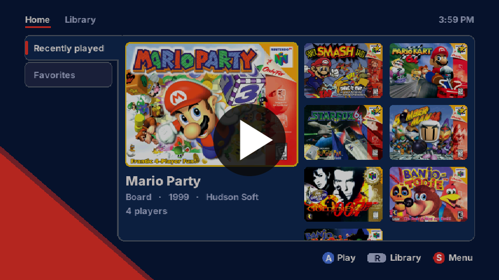](https://youtu.be/wUVdsapzvcc)

**[▶ Watch the demo video](https://youtu.be/wUVdsapzvcc)**

**[Download the latest release](https://github.com/WarioBringus/SC64-Launcher/releases/latest)**: everything needed for the SD card plus Windows tools for box
art, game details and music. No games are included.

---

## Screenshots

Shown in the Castle Sky theme at 16:9 (every screen also works at 4:3).

**Home**, in four styles:

| | |
|---|---|
| 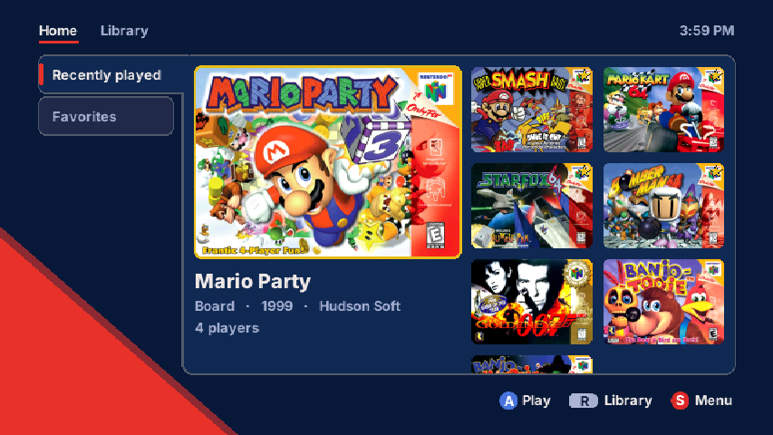 | 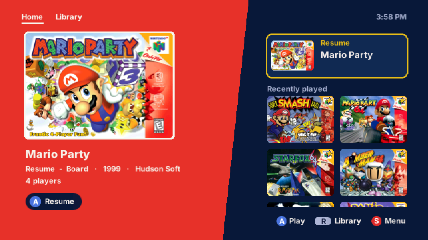 |
| **Binder**: your lists as tabs, the selected game large | **Spotlight**: the selected game on a slanted panel |
| 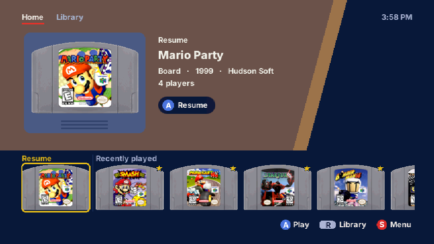 | 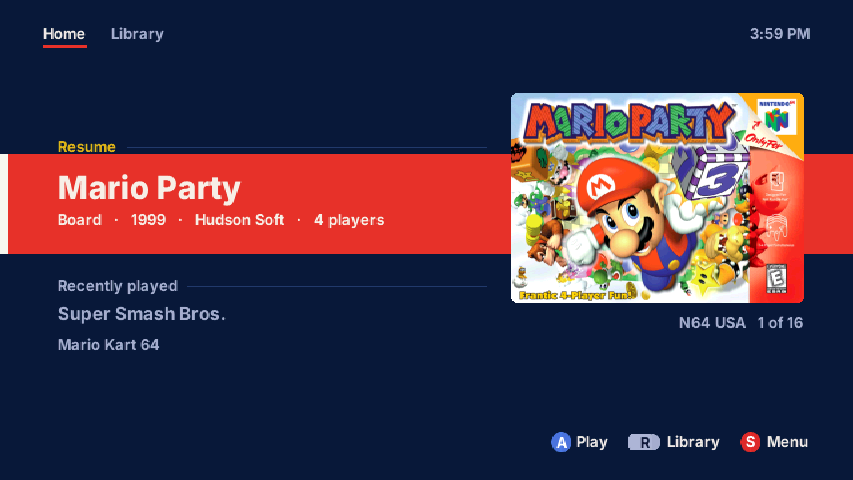 |
| **Cartridge**: cartridge labels on a band in the label's colour | **Minimal**: the game names are the menu |

**Library**, in three layouts:

| | |
|---|---|
| 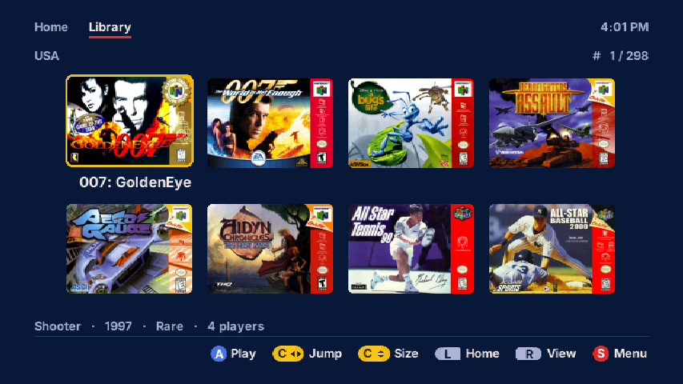 | 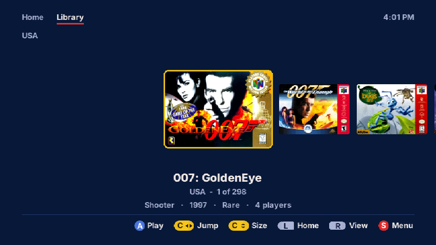 |
| **Grid**, in three tile sizes | **Carousel** |
| 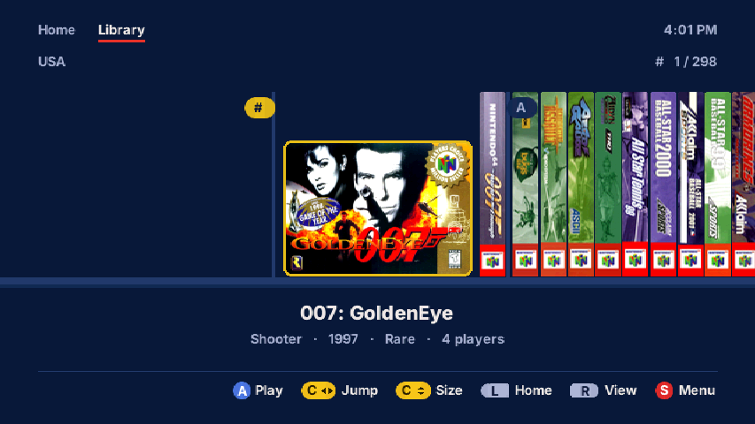 | |
| **Shelf**, with real box spines | |

**Quick menu** (Start): search, this game's options, theme, Home style and music, wherever you are:

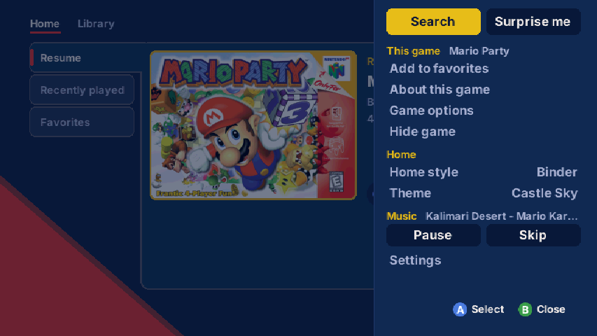

**Themes**: 17 in all, each readable on every screen. Here are four of them, on Home in the Spotlight style:

| | |
|---|---|
| 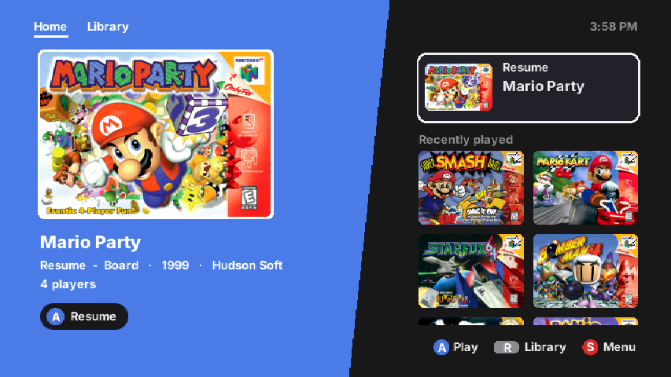 | 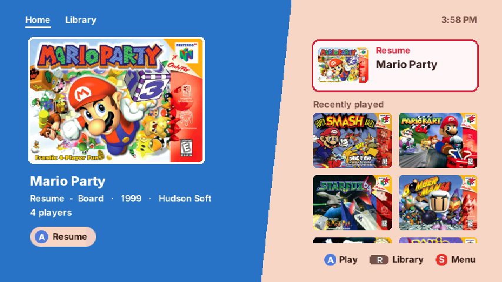 |
| **Midnight** | **Peach Castle** |
| 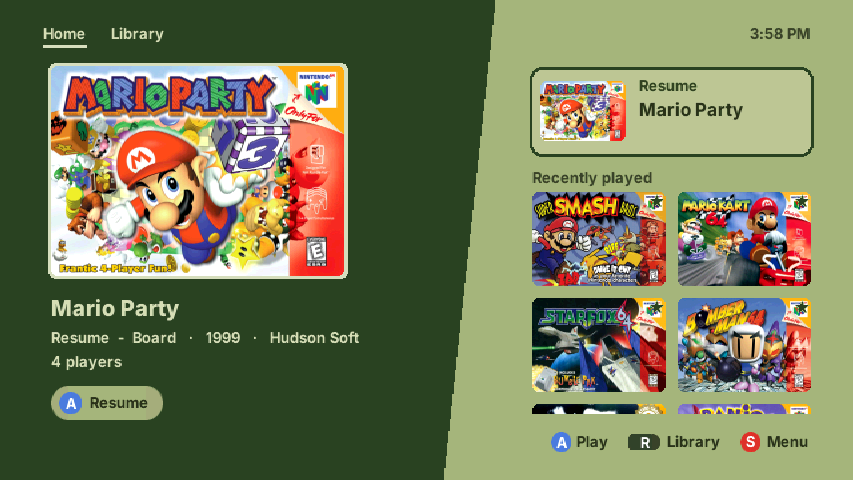 | 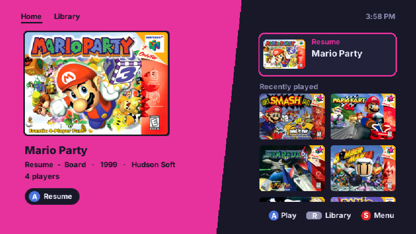 |
| **Pocket Green** | **Arcade** |

## Features

- **Home**: Resume, Recently played and Favorites, in four styles (Binder, Spotlight, Cartridge, Minimal). Move
  favorites around with Z.
- **Library**: each game folder is a tab, in three layouts (Grid, Carousel, Shelf with real box spines) and three tile
  sizes. Sort by title, genre, developer, year or players; filter, jump between groups, search, or let it pick a
  random game.
- **Box art everywhere**: covers, cartridge labels, box spines and large hi-res covers, pre-scaled on your PC so the
  N64 never has to.
- **Game details**: genre, developer, publisher, year, players and more, on screen and in sorting.
- **17 colour themes**, each readable on every screen, in 16:9 or 4:3.
- **Background music** from your own MP3 or WAV files.
- **One Quick menu (Start)** for search, the selected game's options, theme, Home style and music, plus a tabbed
  Settings page made for reading from the couch.
- **Any ROM names**: covers and details are found from the game code inside each ROM, so dumps from any source, region
  or byte order (.z64, .v64, .n64) work. Titles are tidied ("Legend of Zelda, The (USA) (Rev 2)" shows as "The Legend
  of Zelda").
- The **original menu and file browser** are still one setting away.

## Requirements

| | |
|---|---|
| **SummerCart64** | Firmware 2.17.0 or newer (tested with 2.20.2) |
| **Console** | Analogue 3D, tested with firmware 1.5.1 (should work with that or newer); or an original N64 with an Expansion Pak (covers load more slowly there) |
| **PC tools** | Windows 10 or 11. Nothing to install: the tools carry their own Python. |
| **Internet** | For the first run of the covers tool (about 60 MB, plus about 1 MB per game) |

## Installing

Full steps are in the release's `README.txt`. In short:

1. Copy everything inside the release's **SD card** folder to the top level of your SD card.
2. Put your games in the game folders **on the card** (N64 USA, N64 Europe, N64 Japan, N64 China, N64 Hacks).
3. With the card in your PC, double-click **Get covers and game info.bat**, pick your SD card in the window, and
   press the button.
4. Optional: double-click **Music converter.bat** to add background music.
5. Put the card in your SummerCart64 and turn the console on.

Home starts empty: it fills with the games you play and the favorites you add. Sound effects and music are on
from the start (the menu's built-in track plays until you add your own); turn them off in **Settings > Sound**. Added or removed games? Run the covers
tool again.

**Recommended display settings**: on the Analogue 3D, set the image scaler to **Stretch**, and in the launcher set
**Settings > Look > Screen** to **16:9**. That's only a recommendation; every screen is laid out for both 16:9 and 4:3,
so use whatever combination you're comfortable with.

**Getting back to the launcher from a game**: on the Analogue 3D, press the star button on the controller and
choose **Reset**; on an original N64, press the console's Reset button. You land on Home, with the game under
Resume. This needs **Settings > Games > Fast reboot** set to **Off** (the default); with it on, Reset starts the
same game again.

**Updating**: replace `sc64menu.n64` on the card. Your settings, favorites and covers stay.

**ROM hacks**: only use hacks made to run on real hardware. Hacks made for PC emulators won't run on a SummerCart64
or an Analogue 3D; please don't report those as launcher problems.

---

## Disclaimers

**No games are included, and none will be provided.** This is a front end for games you supply yourself. Please use
dumps of games you own, and don't ask for ROMs in the issues.

**I don't claim ownership of anything this works with.** The games, their names, box art, cartridge art and
trademarks belong to their respective owners (Nintendo and the games' publishers and developers). Box art comes from
community projects (credited below) or is downloaded to your own PC by the covers tool. N64FlashcartMenu, libdragon, the
SummerCart64 and everything else credited below belong to their authors.

**Not affiliated** with Nintendo, Analogue, the SummerCart64 project, the N64FlashcartMenu team, LaunchBox or
libretro. This is an independent, free, non-profit fan project.

**Game information may be wrong.** Titles, genres, developers, years and other details come from community databases and
can be incomplete or inaccurate. If you spot something wrong:
- fix it on your own card with `menu/game-fixes.txt` (see the release's README.txt), and/or
- let me know in the [issues](https://github.com/WarioBringus/SC64-Launcher/issues), and/or
- fork this and make it your own. Improvements are welcome.

**Use at your own risk.** It's provided as is, without any warranty (see the licence). It never touches the
SummerCart64's firmware or settings, but **back up your SD card and your saves** before installing anything new on it.

**Made with AI.** This was "vibe coded": built with [Claude Code](https://claude.com/claude-code) by a motion designer, not
a programmer. It has been tested on the hardware above, but it hasn't been reviewed like a professional project, so
please report anything odd.

---

## Forking and contributing

Forks are welcome: make it your own, fix the game data, add themes, port the tools to Mac or Linux. Like the menu it's
built on, this is licensed under the **GNU AGPL-3.0**, so forks must stay open source under the same licence and keep
the credits and licence notices.

**Building it yourself, or working on it with Claude Code?** [CLAUDE.md](CLAUDE.md) explains the Windows build, where
everything is in the code, the rules that keep it fast and readable, and how to test and make a release. Claude Code
reads it automatically when you open the project.

Bug reports are most useful with:
- the build number (Settings > System > Menu information),
- your console (Analogue 3D or N64) and its firmware, and your SummerCart64 firmware,
- what you did and what happened. A photo of the screen helps.

## Credits

- **[N64FlashcartMenu](https://github.com/Polprzewodnikowy/N64FlashcartMenu)**: the menu this is built on (AGPL-3.0)
- **[libdragon](https://libdragon.dev)**: the N64 development library it uses (Unlicense)
- **[SummerCart64](https://github.com/Polprzewodnikowy/SummerCart64)**: the flashcart itself
- **Box art and metadata**: [N64 Flashcart Menu metadata project](https://github.com/n64-tools/n64-flashcart-menu-metadata) (Unlicense)
- **Game details**: [libretro-database](https://github.com/libretro/libretro-database) (CC BY-SA 4.0)
- **Extra box spines**: the [LaunchBox Games Database](https://gamesdb.launchbox-app.com)
- **Extra covers**: [libretro-thumbnails](https://github.com/libretro-thumbnails)
- **[Inter](https://rsms.me/inter/)** typeface by Rasmus Andersson (SIL Open Font License 1.1)
- **libspng** and **miniz**, used by the cover tool (BSD-2-Clause / MIT)
- **[Python](https://www.python.org)**, bundled with the PC tools (PSF License)

## Licence

[GNU Affero General Public License v3.0](LICENSE.md), the same as N64FlashcartMenu. This project modifies
N64FlashcartMenu: the launcher (Home, Library, Quick menu, themes, music and the restyled screens) and the PC tools are
the changes, and the full history of what changed is in this repository's commits.
